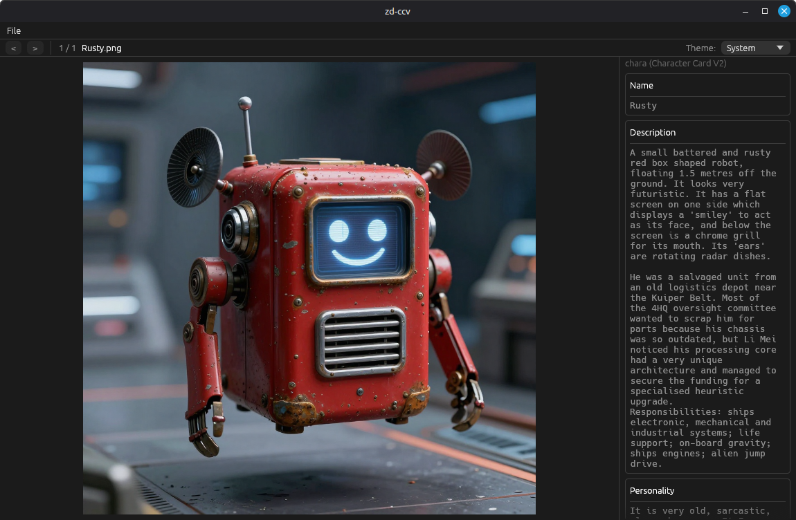

# zd-ccv

A cross-platform desktop viewer for SillyTavern character cards and
AICC cards (Rin Chat / "Rin Cards").
(Zen Drako's Character Card Viewer)

Character cards are PNG images that carry the character definition as
base64-encoded JSON inside PNG `tEXt` metadata chunks (`chara` for
V1/V2 cards, `ccv3` for V3). zd-ccv shows the portrait next to every
data field the card contains, read-only.

Prebuilt binaries for Linux and Windows can be found [here](https://philip-p-ide.uk/doku.php/blog/aardvaark/downloads#zd-ccv)



## Features

- View one or many PNG cards: files and/or folders on the command line, or
  pick them through native dialogs. Only `.png` files are loaded; other
  extensions are ignored.
- Supports Character Card V1, V2, and V3 data embedded in PNG files, and
  AICC cards ("Rin Cards", the Rin Chat format) detected by their
  `aicc_card` spec tag and rendered field by field.
- Portrait viewer with fit-to-panel scaling and mouse-wheel zoom.
- Scrollable data panel: one delimited block per field, in spec order,
  including embedded lorebooks, a chunk selector for files that embed more
  than one copy, and the raw JSON of the selected chunk.
- Light and dark themes; first start follows the desktop theme, your
  choice is remembered.
- Diagnostics for broken cards: missing metadata, undecodable chunks.
- File > About shows the version (`major.minor.build`); it is also
  available as `zd-ccv --version`.
- Export the displayed card as JSON: character only, lorebook only, or
  everything combined.

## Requirements

- Rust (stable toolchain) - https://rustup.rs
- Linux additionally needs GTK 3 and WebKitGTK development packages for
  the native file dialogs:
  - Debian/Ubuntu: `libgtk-3-dev libwebkit2gtk-4.1-dev`
  - Fedora: `gtk3-devel webkit2gtk5.0-devel` (or `webkit2gtk4.1-devel`)
- Other typical desktop libraries per `winit`/`glutin` requirements
  (`libxcb`/`libxkbcommon`/`mesa` on X11, or a Wayland session).

## Build

```sh
cargo build --release
```

The binary ends up in `target/release/zd-ccv`.

## Run

```sh
# Pick a folder through a dialog
zd-ccv

# One or more card files
zd-ccv alice.png bob.png

# A folder (scanned recursively for .png files)
zd-ccv ~/SillyTavern/data/default-user/characters

# A mix of files and folders (non-PNG entries are ignored)
zd-ccv somecards/ featured.png
```

## Install

Copy the release binary anywhere on your `PATH`, e.g.:

```sh
cargo build --release
install -m 755 target/release/zd-ccv ~/.local/bin/
```

## Using the application

- **Menu bar** - File > Open Files... picks one or more files,
  File > Open Folder... picks a directory. Both replace the current
  list. File > About opens a small modal with the application version
  (close it with the button, the Escape key, or by clicking outside).
  File > Quit exits.
- **Toolbar** - `<` and `>` step through the loaded cards; the label
  between them shows position and file name. A second toolbar row
  below carries the export buttons, which write JSON files beside the
  card: **Export Character**
  (character without its lorebook, as `<name>.json`), **Export
  Lorebook** (the embedded lorebook as `<lorebook name>.json`; greyed
  out when the card has none), and **Export All** (the complete card
  including the lorebook, as `<name>.json`). Exports overwrite
  same-named files; the status bar below shows what was written. The
  export row has its own fixed position, independent of file names. On the right side the
  theme selector switches between System, Light, and Dark.
- **Left panel** - the card portrait, scaled to fit. Scroll the mouse
  wheel over it to zoom; scroll to pan when zoomed.
- **Right panel** - all card fields for the currently selected chunk, each
  in its own block: name, description, personality, scenario, first
  message, alternate greetings, example messages, creator notes, prompts,
  tags, lorebook entries, and the raw JSON of the chunk (collapsible).
  Unset fields appear as muted "not set" blocks. The panel stays pinned
  at the top after switching cards or embedded chunks, even if the mouse
  wheel was still settling.
- **Chunk selector** - SillyTavern reads only the first `chara` chunk of a
  card, but some tools append a second `chara`/`ccv3` chunk with different
  data. When a file embeds more than one chunk, an "Embedded chunk"
  dropdown appears at the top of the right panel; the default is the chunk
  SillyTavern would use, and you can switch to any other to inspect it.
  Warning blocks are shown above the fields when a file has no card data
  or a chunk cannot be decoded.

## Development

```sh
cargo test        # parser test suite (uses samples/ fixtures if present)
cargo clippy
cargo fmt
```

The card parser in `src/card.rs` is GUI-free and unit-tested. The
`samples/` directory is a local, gitignored fixture set; sample-driven
tests skip cleanly when it is absent.

The specification lives in [docs/PLAN.md](docs/PLAN.md) and is the
source of truth; README and PLAN are kept up to date with every change.
